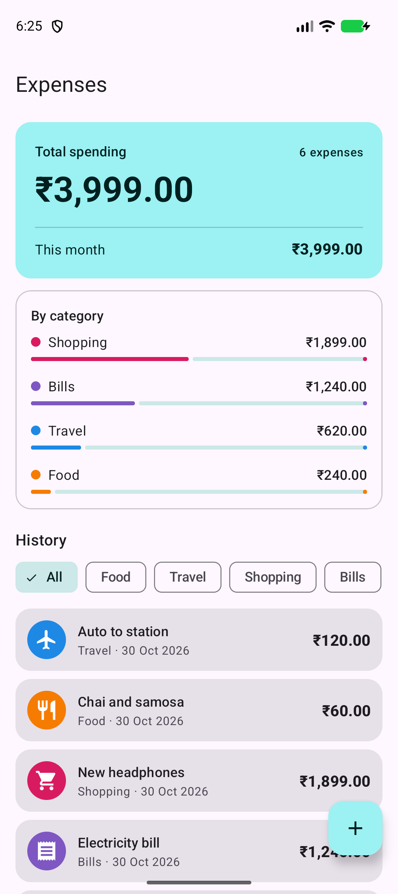
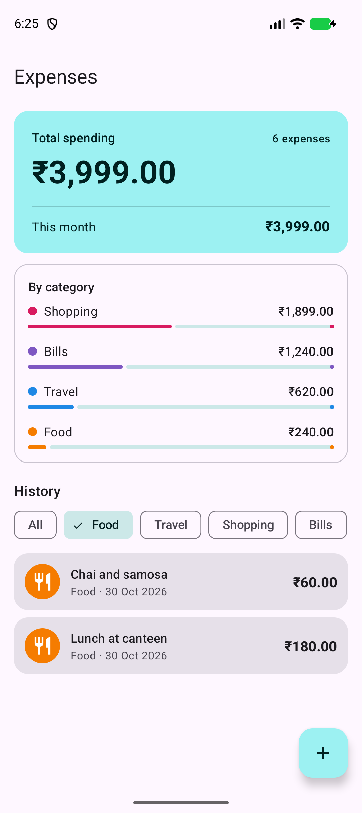
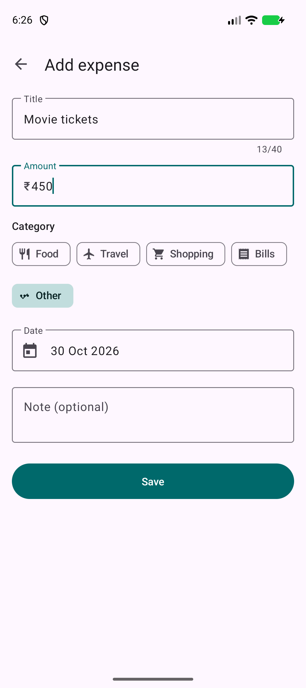
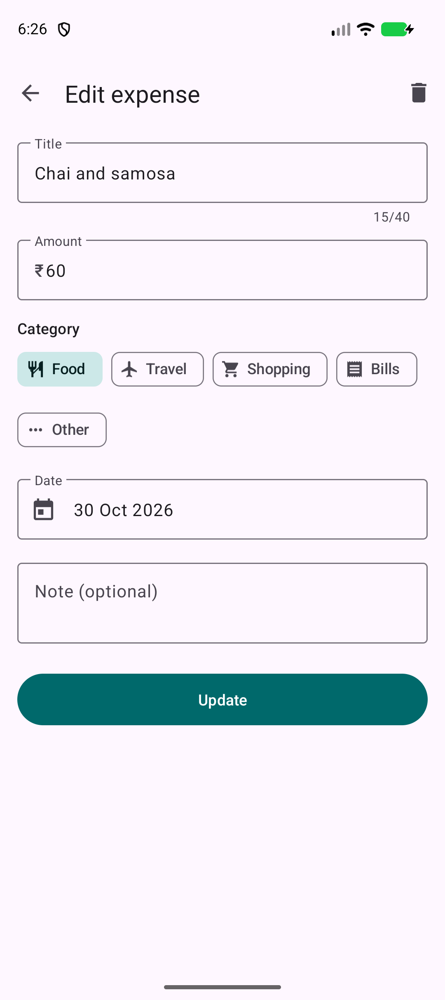

# Expense Tracker (Android, Kotlin)

Auspify Technologies internship, Task 2.

An Android app to record daily expenses and see where the money goes.

## Progress

- [x] Step 1: Two screens: the expense list, and a form to add or edit an expense (title, amount, category, date, note) with checks for empty or invalid values
- [x] Step 2: Categories Food, Travel, Shopping, Bills and Other, each with its own icon and colour, picked with chips
- [x] Step 3: Expenses saved locally in a Room (SQLite) database, through a DAO, repository and ViewModel
- [x] Step 4: History list sorted by date (newest first) with category filters, plus a summary card with the total spent, this month's spending and a per-category breakdown
- [x] Step 5: Tap an expense to edit it; delete it from the edit screen (with a confirmation) or by swiping the row away (with Undo)

## Built with

Kotlin, XML layouts with view binding, Material Components (Material 3, light and dark theme), Room, ViewModel + LiveData, RecyclerView. Min SDK 24.

## Run

Open the folder in Android Studio and press Run, or build from the terminal:

```
./gradlew assembleDebug
```

Unit tests for the totals and date helpers:

```
./gradlew testDebugUnitTest
```

| Expense history | Filter by category |
| --- | --- |
|  |  |

| Add an expense | Edit or delete |
| --- | --- |
|  |  |
